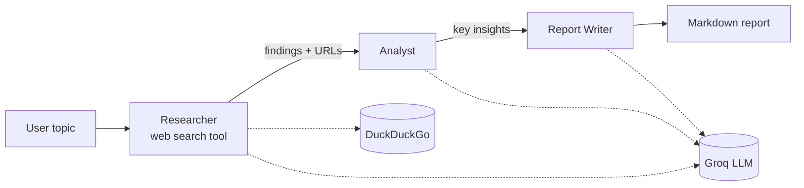

# 🔎 AI Research Agent

A multi-agent AI system that turns a topic into a structured Markdown research report. Three specialised agents (Researcher, Analyst, Report Writer) work in sequence using **CrewAI**, **Groq** for LLM inference and **DuckDuckGo** for web search. Use it from a **Streamlit** app or a **Jupyter notebook**.

## Features

- Three-agent pipeline: research, analysis, report writing
- Live web search (DuckDuckGo, 5-7 sources per run)
- Streamlit dashboard with per-agent status and Markdown download
- Notebook and app share the same agent code (`agents.py`, `tools.py`)
- One shared, configurable Groq model (`.env`)
- Handles invalid API key, rate limits, network failures, empty topics, search failures and missing environment variables
- API keys stay in `.env` and are never shown in the UI or logs

## Architecture



## Tech stack

Python 3.10-3.13 · CrewAI · Groq (via LiteLLM) · Streamlit · DuckDuckGo (`ddgs`) · python-dotenv · Jupyter

## Project structure

```
AI-Research-Agent/
├── AI_Research_Agent.ipynb   # step-by-step notebook
├── app.py                    # Streamlit frontend
├── agents.py                 # LLM config, agents, tasks, crew, run_research()
├── tools.py                  # DuckDuckGo search tool
├── list_models.py            # lists Groq models your key can use
├── requirements.txt
├── .env.example
└── .gitignore
```

## Installation

```bash
git clone <your-repo-url>
cd AI-Research-Agent
python -m venv .venv
.venv\Scripts\activate          # macOS/Linux: source .venv/bin/activate
pip install -r requirements.txt
```

> CrewAI does not support Python 3.14 yet. Use Python 3.10-3.13.

## Environment setup

1. Create a free key at [console.groq.com/keys](https://console.groq.com/keys).
2. Copy the template: `copy .env.example .env` (macOS/Linux: `cp .env.example .env`).
3. Put your key in `.env`.
4. Run `python list_models.py` and set `GROQ_MODEL` to one of the printed ids. Groq retires models regularly, so a hard-coded name can break.

| Variable | Purpose | Default |
|---|---|---|
| `GROQ_API_KEY` | Groq API key | required |
| `GROQ_MODEL` | Model id (no `groq/` prefix) | required |
| `MAX_SEARCH_RESULTS` | Search results per query (1-7) | 6 |
| `MAX_OUTPUT_TOKENS` | Output cap per LLM call | 2000 |

## Run

**Streamlit app**

```bash
streamlit run app.py
```

**Notebook**

Open `AI_Research_Agent.ipynb`, select the `.venv` kernel and run the cells in order.

**Command line**

```bash
python agents.py "Impact of AI on healthcare"
```

## Testing

| Test | Command | Expected |
|---|---|---|
| Search only (no API key needed) | `python tools.py "what is RAG"` | Numbered results with URLs |
| Model list | `python list_models.py` | Model ids |
| Full pipeline | `python agents.py "Electric vehicles in India"` | `[done]` x3, then a Markdown report |
| Empty topic | Click **Run research** with an empty box | Warning message |
| Missing key | Blank `GROQ_API_KEY` in `.env` | Clear error, no crash |
| Bad model | Set `GROQ_MODEL=nonexistent` | "model was not found" message |
| Offline | Disconnect the internet | Network or search-failure message |

## Output format

Every report follows this structure:

```markdown
# <Title>
## Introduction
## Key Findings
## Analysis
## Conclusion
## Sources
```

Add a real report here after your own run, for example a screenshot or an excerpt saved under `examples/`.

## Troubleshooting

- **`No matching distribution found for crewai`**: your Python is too new; use 3.10-3.13.
- **`model_not_found`**: run `python list_models.py` and update `GROQ_MODEL`.
- **Rate limit (429)**: wait a minute or choose a smaller model.
- **Odd file errors on Windows**: avoid keeping the project and `.venv` inside OneDrive.

## Limitations

- Reports are based on search-result snippets, not full page content, so verify important claims with the cited sources.
- The Researcher is limited to 2 searches per run to control cost.
- Token usage and quality have not been benchmarked.

## Future improvements

- Fetch and summarise full pages for deeper research
- Add a fact-checker agent
- Export reports to PDF
- Save report history
- Measure token usage and latency per agent
- Add automated tests and CI
